# Система учёта посещаемости — полное описание

## Краткое описание проекта

Система учёта посещаемости предназначена для автоматической отметки студентов на занятиях с помощью бесконтактных студенческих пропусков. Преподаватель использует Android-приложение: подносит пропуск к телефону, приложение считывает UID, подписывает запрос приватным ключом из Android Keystore и отправляет на сервер. Сервер проверяет подпись, находит студента и фиксирует время входа или выхода.

В системе три роли: преподаватель (отмечает и смотрит списки), админ (управляет студентами, кодами регистрации и устройствами) и сотрудник вуза (принимает и проверяет бумажные согласия и заявления). Студент взаимодействует с системой только через пропуск и бумажные документы.

Обработка персональных данных ведётся на основании бумажных согласий. При отзыве согласия персональные данные зануляются, а записи о посещаемости сохраняются в обезличенном виде. Согласия, заявления и акты об уничтожении существуют на бумаге и хранятся в деле вуза.

## Предусловия и границы проекта

**В скоуп входит:**
- Регистрация Android-устройства преподавателя через одноразовый код.
- Отметка посещаемости студента путём чтения UID студенческого пропуска.
- Расписание пар: импорт `.ics`-файла в админ-панели, список пар преподавателя (свежие сверху, с фильтром "Будущие").
- Просмотр списка пришедших по паре, с возможностью отметить вручную.
- Управление студентами, преподавателями, дисциплинами, группами, кодами регистрации и устройствами через админ-панель.
- Учёт согласий и отзывов с фиксацией в базе. Бумажные документы — вне системы.
- Распространение APK преподавателям через ссылку в админ-панели.
- Журнал событий: регистрация неуспешных попыток и важных действий для разбора инцидентов.

**В скоуп не входит:**
- Замена преподавателя. Устройство всегда отмечает от имени того преподавателя, к которому привязано при регистрации.
- Автоматический сбор персональных данных студентов.
- Онлайн-интеграция с расписанием вуза (API, SOAP, 1С). Расписание попадает в систему только разовой загрузкой `.ics`-файла админом; автоматической синхронизации нет.
- Платежи, библиотека, проходная.
- Хранение фотографий студентов для визуальной сверки преподавателем. Фотография, используемая для идентификации личности, может квалифицироваться как биометрические персональные данные (ст. 11 152-ФЗ). Их обработка требует отдельного письменного согласия, что усложняет сбор документов и увеличивает риск штрафов.

**Ручные операции (вне системы):**
- Студент подписывает бумажное согласие на обработку персональных данных.
- Студент подписывает бумажное заявление об отзыве согласия.
- Сотрудник вуза принимает документы, проверяет их и передаёт админу.
- Админ переносит данные в систему и подписывает акт об уничтожении персональных данных.
- Бумажные оригиналы хранятся в деле вуза.

### Используемый носитель

В качестве студенческого пропуска используется карта на базе NXP MIFARE Plus. Исследование показало, что такие карты применяются в кампусных системах. В режиме SL3 данные защищены AES-128, но UID доступен без аутентификации. Для учёта посещаемости достаточно только UID: чтение защищённых секторов не требуется, а без ключей администратора оно и невозможно.

На схемах ниже носитель обозначен как "Студенческий пропуск", чтобы подчеркнуть прикладную роль, а не конкретную модель чипа.

### 152-ФЗ и обработка персональных данных

Обработка персональных данных студентов ведётся на основании бумажного согласия. Согласие фиксируется в системе номером и датой документа. Бумажный оригинал хранится в деле вуза.

При отзыве согласия студент подаёт письменное заявление. Сотрудник вуза принимает и проверяет документ, после чего передаёт его админу. Админ вносит номер и дату заявления в систему. Система зануляет персональные данные студента:
- `full_name = NULL`
- `uid = NULL`

Записи о посещаемости сохраняются в обезличенном виде: они остаются связанными с внутренним `student_id`, но этот идентификатор больше не позволяет определить личность. После отзыва админ формирует и подписывает акт об уничтожении персональных данных. Срок обработки после отзыва — не более 30 дней.

## Технологии

### Выбор технологического стека

Финальные решения по СУБД и фреймворкам принимаются после выбора хостинга.

**Последовательность:**

1. Команда исследует хостинги (совместно или по устной договоренности).
2. Команда определяет хостинг и доступную на нём СУБД: **PostgreSQL 10+** или **MySQL 8.0+**.
3. DB + Admin API пишет миграции и сиды под выбранную СУБД.
4. Схема данных (см. раздел "База данных") описана универсально — в двух колонках указаны типы под обе СУБД. Скрипты пишутся только под одну.

- **PostgreSQL 10+** — из-за `jsonb` и GIN-индексов.
- **MySQL 8.0+** — из-за `JSON`-типа, generated columns и CTE, которые нужны для индексации `meta` в журнале событий.

Все бизнес-требования реализуются на обеих СУБД.

| Решение | Варианты |
|---|---|
| СУБД | PostgreSQL 10+, MySQL 8.0+ |
| Бэкенд | Python (Flask, FastAPI, Django), Node.js, Go |
| Фронтенд | SPA (React, Vue, Svelte), серверные шаблоны (Flask/Jinja2, Django templates) |
| Android | Kotlin + Jetpack Compose (предпочтительно), Kotlin + XML Views |

| Решение | Как решается |
|---|---|
| Конкретные библиотеки (SQLAlchemy и другие) | По мере необходимости после выбора фреймворка |
| ORM | На усмотрение разработчика после выбора фреймворка |
| Инструмент миграций | На усмотрение разработчика. Если фреймворк не требует явных миграций, не усложняем |
| CI/CD | Не нужен для проекта |
| Мониторинг | Только журнал событий |

**На дружественном хостинге** доступен вариант **Flask / FastAPI / Node.js + MySQL без Docker**. Развёртывание ручное, локальная разработка всё равно в Docker с той же СУБД. Может быть использован, если другие варианты не подходят.

**Текущая реализация.** Сейчас проект написан на **Python 3.9+ / Flask + MySQL 8.0+**: доступ к БД через PyMySQL без ORM, админ-панель — на серверных шаблонах Jinja2 внутри того же приложения, миграции и сиды — SQL-скрипты `backend/db/init/01-schema.sql` и `02-seed.sql`. Остальные варианты из таблиц описывают возможные альтернативы, если по итогам выбора хостинга СУБД или фреймворк изменятся.

### Требования к развёртыванию

- **Хостинг**: бесплатный или условно-бесплатный, с поддержкой выбранного стека. Docker не обязателен.
- **Git-хостинг**: GitHub.
- **Репозиторий**: один общий репозиторий (монорепо) с папками `backend/`, `frontend/`, `db/`, `android/`, `docs/`. В корне — `docker-compose.yml`.
- **Рабочая среда**: Docker для зависимостей, локальный рантайм для своего кода.
- **Ветки**: `main` (стабильная) и `dev` (интеграционная). Работа — в отдельных ветках от `dev`.
- **Среды**: предполагается наличие тестовой и продовой среды. Тестовая среда используется для проверок QA и командой: на ней разворачиваются тестовые сборки API, админ-панели и APK. Продовая — для реальной работы преподавателей.
- **Хостинг APK**: файл release-APK хранится в статике на том же хостинге, что API. Ссылка размещается в админ-панели.
- **СУБД**: PostgreSQL 10+ или MySQL 8.0+ — конкретная выбирается по тому, что доступно на найденном хостинге.
- **Доступность API**: API доступен извне. Продовая среда работает по HTTPS; адрес задаётся константой `API_BASE_URL` при сборке APK. Тестовая среда на бесплатном хостинге может работать по HTTP — в этом случае в манифесте Android включён `usesCleartextTraffic`, а cookie админки ставится без флага `Secure` (`COOKIE_SECURE=false`). При переходе на HTTPS обе настройки переключаются: `API_BASE_URL` получает префикс `https://`, `COOKIE_SECURE=true`.
- **Схема транспорта по средам**: прод — HTTPS; тест/локальная разработка — HTTP допускается.
- **Версионирование API**: пути начинаются с `/api/v1/`.
- **Формат ответов**: единый JSON.
- **Минимальная версия Android**: minSdk = 26. Требуется для стабильной работы NFC и Android Keystore.
- **Формат аутентификации админа**: JWT (HS256), срок жизни задаётся `JWT_TTL_HOURS`. Токен передаётся в заголовке `Authorization: Bearer` для API и в cookie `admin_token` для веб-панели.
- **Статика**: APK, макеты и другие медиа лежат в статике на том же хостинге, что API.
- **Журнал событий**: значимые события (неуспешные попытки, ошибки, важные действия) сохраняются в БД и доступны через админ-панель. Технические логи (HTTP-запросы, traceback) пишутся автоматически и доступны через панель хостинга.

## Архитектура системы

### C1. System Context

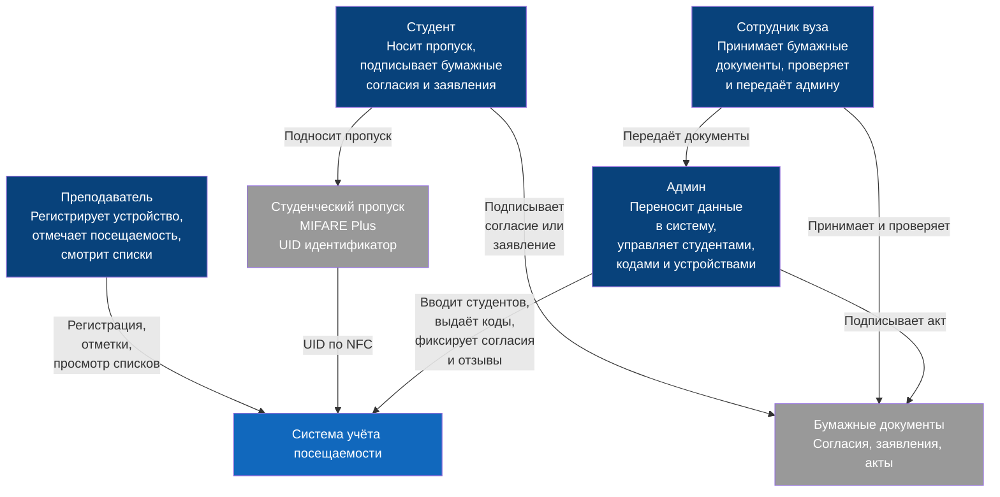

### C2. Container

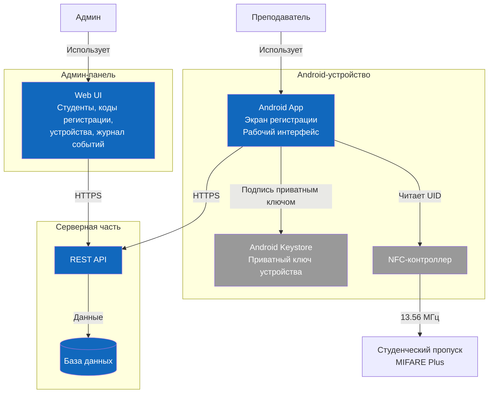

### C3. Component — Android-приложение

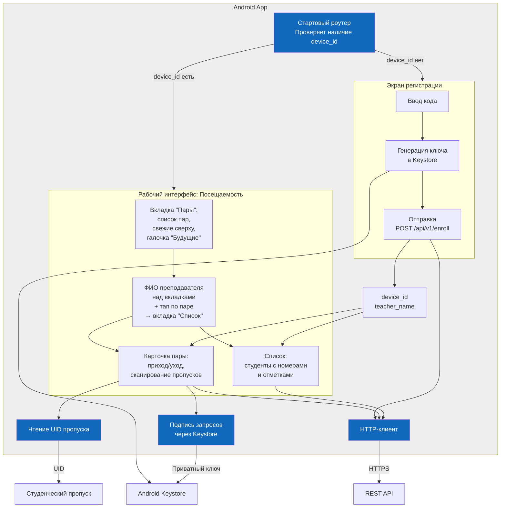

**Логика навигации:**
- При запуске приложение проверяет `device_id` в локальном хранилище.
- Устройство не зарегистрировано → показывается только экран регистрации.
- Устройство зарегистрировано → открывается рабочий интерфейс "Посещаемость".
- Внутри "Посещаемости" — вкладка "Пары" со списком пар преподавателя (свежие сверху) и вкладка "Список" с открытой парой. Отдельных селекторов дисциплины и группы нет.

Если устройство нужно перерегистрировать, администратор удаляет данные приложения на устройстве. При следующем запуске приложение снова покажет экран регистрации.

### C3. Component — Серверная часть

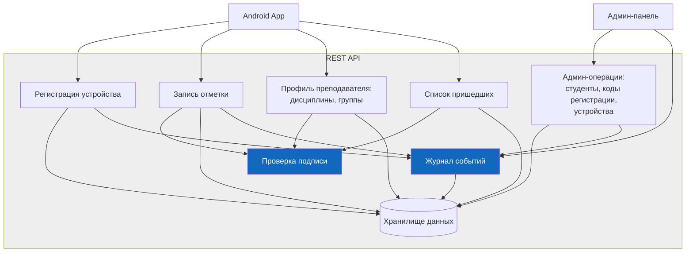

**Проверка при записи отметки:**
- Подпись валидна.
- Устройство активно.
- `teacher_subjects.teacher_id = devices.teacher_id`. Иначе `403 not_your_lesson`.
- `teacher_subjects.active = true`. Иначе `403 no_teacher_subject` (событие `error`).
- Сейчас тот же календарный день, что и у пары по поясу вуза. Иначе `409 lesson_not_today`.

### C4. Deployment

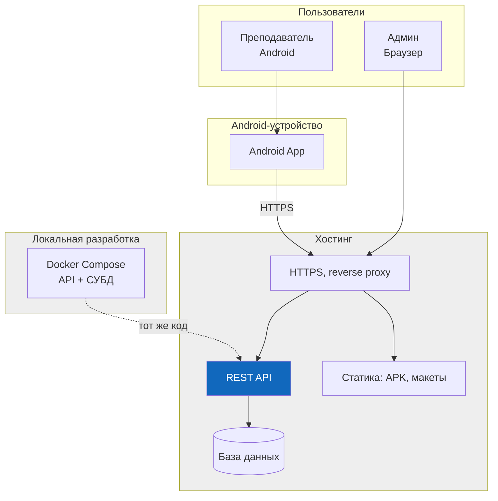

## Криптография и аутентификация

Используется ECDSA и хеш SHA-256. Приватный ключ создаётся в Android Keystore с аппаратной защитой и никогда не покидает устройство. При регистрации на сервер передаётся только публичный ключ.

При каждом запросе Android подписывает строку `method + path + body + timestamp` приватным ключом. Подпись передаётся в заголовке `X-Signature`. Сервер проверяет её публичным ключом, сохранённым при регистрации.

Android Keystore — системное хранилище ключей. На современных устройствах оно опирается на аппаратный модуль, поэтому извлечь приватный ключ даже при root-доступе нельзя.

Формат аутентификации админа — JWT (HS256) с секретом `JWT_SECRET` и сроком жизни
`JWT_TTL_HOURS` (по умолчанию 8 часов). Один и тот же токен принимается в двух видах:
- заголовок `Authorization: Bearer <token>` — для админского REST API;
- cookie `admin_token` — для серверной веб-панели, чтобы не передавать заголовок
  в HTML-формах. На HTTPS cookie ставится с флагом `Secure` (`COOKIE_SECURE=true`).

Серверных сессий нет: токен самодостаточен, отзыв выполняется сменой `JWT_SECRET`.
Пароли админов хранятся в виде bcrypt-хеша (cost — `BCRYPT_COST`).

## Компоненты

Ниже — компоненты системы: ручные операции вокруг бумажных документов, база данных (схема и ER-диаграмма), сервер, Android-приложение и админ-панель.

### Ручные операции

**Согласие при добавлении студента.** Студент подписывает бумажное согласие. Сотрудник вуза принимает и проверяет документ, передаёт админу. Админ вносит студента в систему, указывая номер и дату согласия. Бумажный оригинал хранится в деле.

**Отзыв согласия.** Студент подаёт письменное заявление. Сотрудник вуза принимает и проверяет документ, передаёт админу. Админ заполняет форму отзыва в панели. Система зануляет персональные данные и фиксирует факт отзыва. Оригинал заявления хранится в деле.

**Акт об уничтожении.** Админ формирует акт по шаблону:

```
АКТ ОБ УНИЧТОЖЕНИИ ПЕРСОНАЛЬНЫХ ДАННЫХ

Дата: <дата>
Оператор: <название вуза>

На основании заявления №<номер> от <дата> об отзыве согласия
произведено уничтожение персональных данных студента:
— ФИО
— UID пропуска

Записи о посещаемости сохранены в обезличенном виде.
Восстановление персональных данных невозможно.

Ответственный: <ФИО админа>
Подпись: ______
```

Акт распечатывается, подписывается и хранится в деле.

### База данных

#### Схема данных

Первичные ключи — `id` типа `bigint` с автоинкрементом, если не указано иное. В колонках "Тип (PostgreSQL)" и "Тип (MySQL)" указаны различия между СУБД. Где различий нет — тип одинаков.

**Важно:** таблицы ниже описывают целевую схему, одинаковую для обеих СУБД по смыслу. Скрипты миграций пишутся только под ту СУБД, которая выбрана после определения хостинга. Две колонки с типами — для понимания различий, а не для параллельной разработки. Сейчас в репозитории лежит вариант под MySQL (`backend/db/init/01-schema.sql`); вариант под PostgreSQL пишется, если хостинг будет на нём.

##### admins

Администраторы системы.

| Поле | Тип (PostgreSQL) | Тип (MySQL) | Ограничения | Описание |
|---|---|---|---|---|
| id | bigint | BIGINT | PK, NOT NULL | Первичный ключ |
| login | varchar | VARCHAR | NOT NULL, UNIQUE | Уникальный логин |
| password_hash | varchar | VARCHAR | NOT NULL | bcrypt-хеш пароля, cost 12 |
| active | boolean | TINYINT(1) | NOT NULL, default true | Активен ли админ |
| created_at | timestamptz | TIMESTAMP | NOT NULL | Дата создания |

Индексы:
- `unique (login)`

##### teachers

Преподаватели.

| Поле | Тип (PostgreSQL) | Тип (MySQL) | Ограничения | Описание |
|---|---|---|---|---|
| id | bigint | BIGINT | PK, NOT NULL | Первичный ключ |
| full_name | varchar | VARCHAR | NOT NULL | ФИО |
| active | boolean | TINYINT(1) | NOT NULL, default true | Активен ли преподаватель |
| created_at | timestamptz | TIMESTAMP | NOT NULL | Дата создания |

##### devices

Зарегистрированные Android-устройства.

| Поле | Тип (PostgreSQL) | Тип (MySQL) | Ограничения | Описание |
|---|---|---|---|---|
| id | varchar | VARCHAR | PK, NOT NULL | Идентификатор, генерируется приложением |
| teacher_id | bigint | BIGINT | FK → teachers.id, NOT NULL | Преподаватель, к которому привязано устройство |
| public_key | text | TEXT | NOT NULL | Публичный ключ ECDSA P-256 |
| active | boolean | TINYINT(1) | NOT NULL, default true | Активно ли устройство |
| created_at | timestamptz | TIMESTAMP | NOT NULL | Дата регистрации |

Индексы:
- `index (teacher_id)`

##### enrollment_codes

Одноразовые коды для регистрации устройств.

| Поле | Тип (PostgreSQL) | Тип (MySQL) | Ограничения | Описание |
|---|---|---|---|---|
| code | varchar | VARCHAR | PK, NOT NULL | Случайная строка |
| teacher_id | bigint | BIGINT | FK → teachers.id, NOT NULL | Для кого выдан код |
| created_by_admin | bigint | BIGINT | FK → admins.id, NOT NULL | Кто выдал код |
| expires_at | timestamptz | TIMESTAMP | NOT NULL | Срок действия |
| used_at | timestamptz | TIMESTAMP | NULL | Дата использования |
| created_at | timestamptz | TIMESTAMP | NOT NULL | Дата создания |

##### subjects

Дисциплины.

| Поле | Тип (PostgreSQL) | Тип (MySQL) | Ограничения | Описание |
|---|---|---|---|---|
| id | bigint | BIGINT | PK, NOT NULL | Первичный ключ |
| name | varchar | VARCHAR | NOT NULL | Название |

##### groups

Учебные группы.

| Поле | Тип (PostgreSQL) | Тип (MySQL) | Ограничения | Описание |
|---|---|---|---|---|
| id | bigint | BIGINT | PK, NOT NULL | Первичный ключ |
| name | varchar | VARCHAR | NOT NULL | Название |

##### teacher_subjects

Связь преподавателя с дисциплиной и группой.

| Поле | Тип (PostgreSQL) | Тип (MySQL) | Ограничения | Описание |
|---|---|---|---|---|
| id | bigint | BIGINT | PK, NOT NULL | Первичный ключ |
| teacher_id | bigint | BIGINT | FK → teachers.id, NOT NULL | Преподаватель |
| subject_id | bigint | BIGINT | FK → subjects.id, NOT NULL | Дисциплина |
| group_id | bigint | BIGINT | FK → groups.id, NOT NULL | Группа |
| active | boolean | TINYINT(1) | NOT NULL, default true | Активна ли связь |
| created_at | timestamptz | TIMESTAMP | NOT NULL | Дата создания |

Индексы:
- PostgreSQL: `index (teacher_id, subject_id, group_id) where active = true`
- MySQL: `index (teacher_id, subject_id, group_id, active)`

##### students

Студенты.

| Поле | Тип (PostgreSQL) | Тип (MySQL) | Ограничения | Описание |
|---|---|---|---|---|
| id | bigint | BIGINT | PK, NOT NULL | Первичный ключ |
| full_name | varchar | VARCHAR | NULL | ФИО. Зануляется при отзыве согласия |
| uid | varchar | VARCHAR | NULL, UNIQUE | UID пропуска. Зануляется при отзыве согласия |
| group_id | bigint | BIGINT | FK → groups.id, NOT NULL | Группа |
| consent_document | varchar | VARCHAR | NOT NULL | Номер бумажного согласия |
| consent_date | date | DATE | NOT NULL | Дата подписания согласия |
| revocation_document | varchar | VARCHAR | NULL | Номер заявления об отзыве |
| revocation_date | date | DATE | NULL | Дата заявления об отзыве |
| anonymized_at | timestamptz | TIMESTAMP | NULL | Дата фактического обезличивания |
| created_at | timestamptz | TIMESTAMP | NOT NULL | Дата добавления |

Индексы:
- `unique (uid)`

##### attendance

Отметки посещаемости.

| Поле | Тип (PostgreSQL) | Тип (MySQL) | Ограничения | Описание |
|---|---|---|---|---|
| id | bigint | BIGINT | PK, NOT NULL | Первичный ключ |
| student_id | bigint | BIGINT | FK → students.id, NOT NULL | Студент |
| teacher_subject_id | bigint | BIGINT | FK → teacher_subjects.id, NOT NULL | Связь "преподаватель + дисциплина + группа" |
| device_id | varchar | VARCHAR | FK → devices.id, NOT NULL | С какого устройства отмечено |
| event_type | varchar | VARCHAR | NOT NULL | `check_in` / `check_out` |
| timestamp | timestamptz | TIMESTAMP | NOT NULL | Время отметки |
| lesson_id | int | INT | FK → lessons.id (`ON DELETE CASCADE`), NULL | Конкретная пара |
| source | enum | ENUM | NOT NULL, default `nfc` | `nfc` — приложена карта, `manual` — отмечено вручную |

Индексы:
- `index (teacher_subject_id, timestamp)`
- `index (student_id)`
- `index (lesson_id)`
- `index (source)`

##### lessons

Пары из расписания. Ручного "начать пару" нет: время пары задаётся импортом
ICS, а статус вычисляется от него, без отдельной колонки:
- `now < starts_at` — запланирована (`not_started`)
- `starts_at <= now < ends_at` — идёт (`active`)
- `now >= ends_at` — завершена (`finished`)

| Поле | Тип (PostgreSQL) | Тип (MySQL) | Ограничения | Описание |
|---|---|---|---|---|
| id | bigint | BIGINT | PK, NOT NULL | Первичный ключ |
| teacher_subject_id | bigint | BIGINT | FK → teacher_subjects.id (`ON DELETE CASCADE`), NOT NULL | Связь "преподаватель + дисциплина + группа" |
| lesson_type | varchar | VARCHAR | NOT NULL, default `Другое` | Тип пары из ICS (ЛК, ПЗ, ЛР и т. п.) |
| room | varchar | VARCHAR | NULL | Кабинет |
| starts_at | timestamptz | TIMESTAMP | NOT NULL | Начало пары (UTC) |
| ends_at | timestamptz | TIMESTAMP | NOT NULL | Окончание пары (UTC) |

Индексы:
- `unique (teacher_subject_id, starts_at)` — не даёт повторному импорту того же ICS создать дубликаты

**Модель пары.** Отметки посещаемости (`attendance.lesson_id`) привязаны к
конкретной паре, поэтому две пары одной группы в один день не смешиваются.
Отметки бывают двух видов (`attendance.source`):
- `nfc` — приложена карта (по умолчанию);
- `manual` — преподаватель отметил вручную по тапу в списке.

**Окно отметки — весь календарный день пары по поясу вуза.** Преподаватель может
начать отмечать чуть раньше звонка и закончить позже, поэтому проверка не
ограничивается интервалом `starts_at`-`ends_at`. День пары вычисляется из
`starts_at` в поясе `SCHEDULE_TZ`, отдельная колонка с датой не хранится.

Пары создаются только импортом расписания (см. "Диаграммы последовательности").

##### event_log

Журнал событий: неуспешные попытки и важные действия. Используется для разбора инцидентов.

| Поле | Тип (PostgreSQL) | Тип (MySQL) | Ограничения | Описание |
|---|---|---|---|---|
| id | bigint | BIGINT | PK, NOT NULL | Первичный ключ |
| event_type | varchar | VARCHAR | NOT NULL | Тип события |
| severity | varchar | VARCHAR | NOT NULL | `info` / `warning` / `error` |
| meta | jsonb | JSON | NOT NULL, default '{}' | Контекст события |
| timestamp | timestamptz | TIMESTAMP | NOT NULL | Время события |

**Индексы PostgreSQL:**
- `index (timestamp)`
- `index (severity, timestamp)`
- `index (event_type, timestamp)`
- `index using gin (meta)` — для фильтрации по полям внутри JSONB

**Индексы MySQL:**
- `index (timestamp)`
- `index (severity, timestamp)`
- `index (event_type, timestamp)`
- Generated column + индекс по `device_id` — единственное поле `meta`, по которому
  журнал фильтруется в MVP:
  ```sql
  device_id VARCHAR(64) GENERATED ALWAYS AS
      (JSON_UNQUOTE(JSON_EXTRACT(meta, '$.device_id'))) STORED,
  INDEX idx_device_id (device_id)
  ```
  `uid` и остальные поля `meta` остаются только в JSON: экран журнала их показывает,
  но не фильтрует.

##### Типы событий

**Безопасность:**

| Событие | Severity | Когда возникает |
|---|---|---|
| invalid_signature | error | Подпись не сходится |
| expired_timestamp | warning | Timestamp старше 30 секунд |
| unknown_device | error | `device_id` не найден в БД |
| device_revoked | warning | Устройство отозвано |
| admin_login | info | Успешный вход администратора (API или веб-панель) |
| admin_login_failed | warning | Неверный логин или пароль админа |
| admin_logout | info | Выход администратора из веб-панели |
| admin_password_changed | warning | Смена пароля администратора |
| admin_password_change_failed | warning | Введён неверный текущий пароль при смене пароля |

**Регистрация устройства:**

| Событие | Severity | Когда возникает |
|---|---|---|
| enroll_code_invalid | warning | Кода нет в БД |
| enroll_code_expired | info | Код истёк |
| enroll_code_used | warning | Код уже использован |
| enroll_device_exists | info | `device_id` уже зарегистрирован |
| enroll_success | info | Устройство успешно зарегистрировано по коду |

**Отметки посещаемости:**

| Событие | Severity | Когда возникает |
|---|---|---|
| unknown_uid | warning | Карта не найдена в `students` |
| consent_revoked | info | Согласие отозвано |
| no_teacher_subject | error | Пара принадлежит преподавателю, но связь `teacher_subjects` деактивирована. Отметка и открытие пары отклоняются |
| student_wrong_group | warning | Студент не из выбранной группы |
| duplicate_check_in | info | Повторный `check_in` в той же паре |
| duplicate_check_out | info | Повторный `check_out` в той же паре |
| check_out_without_in | warning | `check_out` без `check_in` |
| lesson_not_today | warning | Попытка отметить пару в чужой календарный день (день пары по поясу вуза уже прошёл) |
| attendance_marked | info | Успешная отметка ("пульс"). В `meta` только `attendance_id`, `event_type`, `source`; полные ссылки (студент, пара, устройство) — в таблице `attendance` |
| attendance_deleted | warning | Удаление отметки преподавателем или админом |
| not_your_lesson | warning | Попытка отметить/открыть чужую пару |
| lesson_attendance_viewed | info | Преподаватель открыл пару с отметками студентов (чтение ПДн) |

**Расписание:**

| Событие | Severity | Когда возникает |
|---|---|---|
| schedule_imported | info | Успешный импорт ICS (после COMMIT) |
| schedule_import_failed | error | Ошибка парсинга или транзакции (ROLLBACK) |
| schedule_cleared | warning | Полная очистка запланированных пар |

**Админ-операции:**

| Событие | Severity | Когда возникает |
|---|---|---|
| student_consent_missing | warning | Добавление студента без обязательных полей согласия |
| revoke_without_document | warning | Отзыв согласия без номера заявления |
| device_deleted | warning | Физическое удаление устройства, у которого нет отметок |
| student_created | info | Создание студента |
| student_updated | info | Изменение данных студента |
| student_deleted | warning | Физическое удаление студента |
| student_pii_viewed | info | Открытие карточки студента (чтение ПДн, админ) |
| teacher_created / teacher_updated | info | Создание / изменение преподавателя |
| teacher_deleted | warning | Удаление преподавателя |
| subject_created / subject_updated | info | Создание / изменение дисциплины |
| subject_deleted | warning | Удаление дисциплины |
| group_created / group_updated | info | Создание / изменение учебной группы |
| group_deleted | warning | Удаление учебной группы |
| teacher_subject_created / teacher_subject_updated | info | Создание / изменение связи преподаватель — дисциплина — группа |
| teacher_subject_deleted | warning | Удаление связи |
| enrollment_code_generated | info | Генерация кода регистрации для преподавателя |
| students_exported | warning | CSV-выгрузка списка студентов (чтение ПДн) |
| attendance_exported | warning | CSV-выгрузка посещаемости (чтение ПДн) |

##### Примеры записей в event_log

Во всех записях `log_event` автоматически дополняет `meta` полями `actor`,
`request_id`, `ip`, `ua` (см. "Автоматический контекст" выше) — в примерах они показаны полностью.

**Невалидная подпись** (`actor = system`: устройство не прошло проверку):
```json
{
  "event_type": "invalid_signature",
  "severity": "error",
  "timestamp": "2026-09-23T10:00:00Z",
  "meta": {
    "device_id": "abc-123",
    "reason": "signature mismatch",
    "actor": "system",
    "request_id": "5f0c1e3a8b2d4c6d9e7f1a2b3c4d5e6f",
    "ip": "10.20.30.40",
    "ua": "okhttp/4.12.0"
  }
}
```

**Карта не найдена** (`actor = device:abc-123`):
```json
{
  "event_type": "unknown_uid",
  "severity": "warning",
  "timestamp": "2026-09-23T10:02:00Z",
  "meta": {
    "device_id": "abc-123",
    "uid": "04:XX:XX:XX",
    "subject_id": 5,
    "group_id": 12,
    "actor": "device:abc-123",
    "request_id": "7d2a4b6c8e0f1a3b5c7d9e1f2a4b6c8d",
    "ip": "10.20.30.40",
    "ua": "okhttp/4.12.0"
  }
}
```

**Отозванное согласие** (`actor = device:abc-123`): карта студента была приложена,
но обрабатывать его данные нельзя:
```json
{
  "event_type": "consent_revoked",
  "severity": "info",
  "timestamp": "2026-09-23T10:05:00Z",
  "meta": {
    "device_id": "abc-123",
    "uid": "04:XX:XX:XX",
    "student_id": 101,
    "actor": "device:abc-123",
    "request_id": "9b1c3d5e7f0a2b4c6d8e0f1a3b5c7d9e",
    "ip": "10.20.30.40",
    "ua": "okhttp/4.12.0"
  }
}
```

**Неудачный вход админа** (`actor = login:admin`):
```json
{
  "event_type": "admin_login_failed",
  "severity": "warning",
  "timestamp": "2026-09-23T10:10:00Z",
  "meta": {
    "login": "admin",
    "reason": "wrong_password",
    "actor": "login:admin",
    "request_id": "1c3e5a7b9d0f2b4c6e8a0f1b3d5c7e9a",
    "ip": "192.0.2.10",
    "ua": "Mozilla/5.0 (Windows NT 10.0; Win64; x64) AppleWebKit/537.36"
  }
}
```

**Неудачный вход админа:**
```json
{
  "event_type": "admin_login_failed",
  "severity": "warning",
  "timestamp": "2026-09-23T10:10:00Z",
  "meta": {
    "login": "admin",
    "reason": "wrong_password"
  }
}
```

**Экран журнала и состав `meta`.** Ниже — как записи из этой таблицы отображаются в админ-панели и какие поля попадают в `meta`.

**Фильтры экрана журнала.** `severity`, тип события (`event_type`), актор
(`actor`), диапазон дат (`date_from`/`date_to`) и флажок "Показать просмотры ПДн".
Колонки `Кто` (`actor`) и `IP` вытаскиваются из `meta` при чтении
(`JSON_UNQUOTE(JSON_EXTRACT(...))`), без изменения схемы и без отдельных индексов.
Селекты типов и акторов строятся по `DISTINCT` из журнала.

Просмотры ПДн (`student_pii_viewed`, `lesson_attendance_viewed`) **пишутся всегда,
но по умолчанию скрыты** в выдаче и CSV; включаются флажком `include_pii_views=1`.
Это убирает шум, не теряя аудит доступа к персональным данным.

**Что в `meta`:** все контекстные поля события — `device_id`, `uid`, `teacher_id`, `subject_id`, `group_id`, `details` и любые другие, специфичные для конкретного типа. Новые типы событий не требуют миграций. Полный состав `meta` для каждого типа событий — в разделе "Типы событий" выше, примеры записей — в разделе "Примеры записей в event_log".

**Автоматический контекст.** Каждая запись дополняется единым набором полей, который заполняет `log_event` (код не указывает их вручную):

| Поле `meta` | Источник | Значение |
|---|---|---|
| `actor` | контекст запроса | `admin:<id>` / `device:<id>` / `login:<login>` / `system`. Можно передать явно. |
| `request_id` | UUID на каждый запрос | Позволяет склеить события одного запроса |
| `ip` | `request.remote_addr` / `X-Forwarded-For` | IP клиента |
| `ua` | заголовок `User-Agent` | Обрезается до 255 символов |

Это **единственное** место в системе, где хранятся IP и User-Agent: тела запросов и содержимое подписи не пишутся.

`actor = system` означает "автор не определён" — событие произошло до аутентификации: неудачный вход (передаётся `login:<login>`), регистрация устройства (`/api/v1/enroll` без подписи), ошибки проверки подписи (`unknown_device`, `invalid_signature`, `expired_timestamp`).

**Что не хранится:** тела запросов, содержимое подписи, **коды регистрации** (`enrollment_codes.code`) — это секрет; в журнале фиксируется только факт генерации/использования с `teacher_id`/`device_id`.

**Минимализм `meta`.** Поля, которые целиком восстанавливаются из первичных таблиц, в `meta` не дублируются:
- `attendance_marked` — только `attendance_id`, `event_type`, `source` (студент/пара/устройство — в `attendance`);
- `lesson_attendance_viewed` — только `lesson_id`;
- `duplicate_check_in/out` — `uid`, `lesson_id`;
- `no_teacher_subject`, `not_your_lesson` — `lesson_id`.

Актора (`device`/`teacher`) восстанавливаем из автополя `actor`, поэтому явно не пишем. Полными остаются только события, после которых исходная строка исчезает (`attendance_deleted`, `device_deleted`, `consent_revoked` — обезличивание) или данных в таблицах нет вовсе (отказы, ошибки подписи).

**Retention — вне MVP.** Автоматическая очистка `event_log` по возрасту (90 дней для обычных событий, 180 для `error`) в текущую версию не входит: ни расписания, ни SQL-задачи в коде нет. Записи журнала накапливаются и при росте объёма чистятся вручную администратором БД. Если очистка понадобится, реализуется отдельно — изменений в схеме не потребует.

#### ER-диаграмма

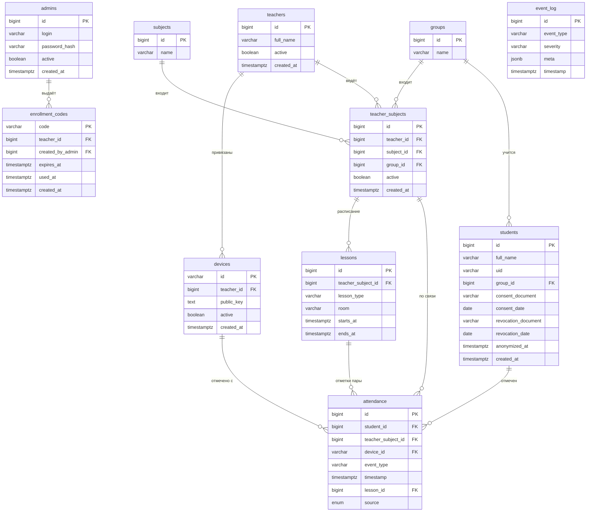

###### Справочник обозначений

| Символ | Значение | Пример в вашей схеме |
|---|---|---|
| `\|\|` | Ровно один (обязательный) | `teachers \|\|--o{ devices` — у устройства ровно один преподаватель |
| `o{` | Ноль или много | `teachers \|\|--o{ devices` — у преподавателя может быть ноль или много устройств |
| `\|{` | Один или много | `attendance }o--\|\| students` — отметка всегда привязана к одному студенту |

| Обозначение | Расшифровка | Где используется |
|---|---|---|
| `PK` | Primary Key, первичный ключ | `bigint id PK` |
| `FK` | Foreign Key, внешний ключ | `bigint teacher_id FK` |

| Связь | Кардинальность | Смысл |
|---|---|---|
| `admins → enrollment_codes` | один ко многим | Один админ выдаёт много кодов |
| `teachers → devices` | один ко многим | Один преподаватель может иметь много устройств |
| `teachers → teacher_subjects` | один ко многим | Один преподаватель ведёт много связей |
| `subjects → teacher_subjects` | один ко многим | Одна дисциплина входит во много связей |
| `groups → teacher_subjects` | один ко многим | Одна группа входит во много связей |
| `groups → students` | один ко многим | В одной группе много студентов |
| `teacher_subjects → lessons` | один ко многим | По одной связи импортируется много пар |
| `teacher_subjects → attendance` | один ко многим | По одной связи много отметок |
| `lessons → attendance` | один ко многим | У пары много отметок (при удалении пары — каскадом) |
| `students → attendance` | один ко многим | У одного студента много отметок |
| `devices → attendance` | один ко многим | С одного устройства много отметок |

**event_log — независимая таблица.** Контекстные ссылки хранятся в `meta` без внешних ключей. Целостность ссылок не проверяется на уровне БД — ответственность за корректность несёт код.

### Сервер

#### Методы API

Все пути имеют префикс `/api/v1/`. Админ-панель (серверные HTML-шаблоны) живёт на
`/admin` и вызывает те же API-методы либо работает с БД напрямую через те же сервисы.

**Регистрация (без подписи):**

```http
POST /api/v1/enroll
{
  "code": "A7K9-2M4P",
  "device_id": "abc-123",
  "public_key": "<ECDSA P-256 public key>"
}
```

В ответе — `device_id`, `teacher_id` и `teacher_name`: приложение показывает ФИО
преподавателя в шапке, чтобы было видно, от чьего имени ставятся отметки.
Код числовой, формат примера выше — общий вид.

**Запросы преподавателя (подпись в заголовке):**

Заголовки:
- `X-Device-Id: abc-123`
- `X-Timestamp: 2026-09-23T10:00:00Z`
- `X-Signature: <подпись приватным ключом устройства>`

```http
GET /api/v1/teacher/lessons?date_from=2026-11-07&date_to=2026-11-07
```

Пары преподавателя за диапазон дат, **свежие сверху**. Без параметров — все пары
по сегодня включительно (вкладка "Пары" без галочки "Будущие"). С `date_to`
в будущем (приложение передаёт сегодня + 30 дней) — ещё и будущие пары.
`date_from` без значения не ограничивает историю. Даты трактуются как
календарные дни в поясе вуза.
В ответе — `items` с полями `id`, `subject_id`, `subject_name`, `group_id`,
`group_name`, `teacher_id`, `teacher_name`, `lesson_type`, `room`,
`date` (день пары по поясу вуза), `starts_at`/`ends_at` (ISO-8601 UTC),
`status` (`not_started` / `active` / `finished`), `marked_count`,
`total_students`.
Пейджинга нет, но есть отсечка: отдаётся не более
`TEACHER_LESSONS_LIMIT` пар (по умолчанию 100, свежие сверху).

```http
GET /api/v1/teacher/lessons/{id}
```

Студенты пары с отметками именно этой пары. В ответе — `lesson` (те же поля, что
в списке) и `students`: `student_id`, `full_name` (`null` у обезличенных), `revoked`,
`check_in`/`check_out` (`{attendance_id, at, source}` либо `null`). Обезличенные
студенты остаются в списке с заглушкой, чтобы преподаватель видел полноту группы.
Чужая пара — `403 not_your_lesson`. Если преподаватель валиден, но связь
`teacher_subjects` деактивирована, пара не открывается — `403 no_teacher_subject`.

```http
POST /api/v1/attendance
{
  "lesson_id": 12,
  "uid": "04:XX:XX:XX",
  "event_type": "check_in",
  "source": "nfc"
}
```

Отметка входа/выхода в конкретной паре. Вместо `uid` можно передать `student_id`
(ручная отметка, `source: "manual"`). Сервер проверяет, что пара принадлежит
преподавателю устройства, что связь `teacher_subjects` активна, и что сейчас
тот же календарный день, что и у пары по поясу вуза. Повторный `check_in`,
`check_out` без `check_in` и второй `check_out` отклоняются.

```http
DELETE /api/v1/attendance/{id}?cascade=true
```

Удаление своей отметки. `cascade=true` — обе отметки пары (вход и выход).

**Админ-операции:**

```http
POST /api/v1/admin/login
POST /api/v1/admin/change-password
```

```http
GET /api/v1/admin/students?group_id=12&consent_status=active&page=1&size=50
```

Список студентов. **Пейджинг предусмотрен.** Фильтры по группе и статусу согласия.

```http
GET /api/v1/admin/students/{id}
```

Карточка студента — для формы редактирования и просмотра истории. В ответе —
все поля `students` плюс вычисляемые `group_name` и `stats`:
`total_marks`, `check_ins`, `check_outs`, `last_seen`. В веб-панели карточка
дополнительно показывает последние 20 отметок (`student_recent_marks`:
дисциплина, группа, преподаватель, тип и время). Отдельного эндпоинта для
последних отметок в API нет — они видны в карточке панели.

```http
POST /api/v1/admin/students
```

```http
PATCH /api/v1/admin/students/{id}
```

Частичное изменение: меняются только переданные поля (`full_name`, `uid`,
`group_id`, `consent_document`, `consent_date`). Обезличенного студента
(после отзыва согласия) редактировать нельзя — `409 student_anonymized`.
Дубликат UID — `400 uid_already_exists`.

```http
DELETE /api/v1/admin/students/{id}
```

Физическое удаление — только для студентов без истории: нет отметок в `attendance`
и нет отзыва согласия. Иначе `409`. Для "убрать из системы" с сохранением истории
используется `/revoke` (обезличивание).

```http
POST /api/v1/admin/students/{id}/revoke
```

```http
POST /api/v1/admin/enrollment-codes
```

```http
GET /api/v1/admin/devices?teacher_id=7&active=true&page=1&size=50
```

Список устройств. **Пейджинг предусмотрен.** Фильтры по преподавателю и статусу.

```http
POST /api/v1/admin/devices/{id}/revoke
```

Отзыв (деактивация) устройства. История отметок сохраняется. Если устройство уже
отозвано — повторный вызов ничего не меняет и не пишет событие.

```http
DELETE /api/v1/admin/devices/{id}
```

Физическое удаление устройства — только если с него нет отметок, иначе `409`.
Пишет событие `device_deleted`.

```http
GET  /api/v1/admin/schedule?date_from=2026-11-01&date_to=2026-11-14&group_id=3
POST /api/v1/admin/schedule/import
DELETE /api/v1/admin/schedule
```

Расписание: список пар за диапазон дат (по умолчанию — неделя назад и неделя
вперёд, отсечка `SCHEDULE_LIST_LIMIT`), импорт `.ics` и полная очистка пар.
Отметки удалённых пар уходят каскадом.

```http
GET /api/v1/admin/event-log?severity=warning&event_type=unknown_uid&date_from=2026-09-01&date_to=2026-09-30&page=1&size=50
```

Журнал событий. **Пейджинг предусмотрен.** Фильтры по severity, типу, дате, полям в `meta`.

Список кодов регистрации отдельным методом не выдаётся: код показывается на фронте один раз при создании. Если нужен новый — генерируется заново.

#### Формат ответов

**Успешный ответ:**
```json
{
  "status": "ok",
  "data": { ... }
}
```

**Ответ с ошибкой:**
```json
{
  "status": "error",
  "message": "Человекочитаемое описание"
}
```

HTTP-статусы используются стандартные: `200` — успех, `400` — невалидные данные, `401` — не аутентифицирован, `403` — нет доступа, `404` — не найдено.

#### Сводка по пейджингу

| Метод | Пейджинг | Причина |
|---|---|---|
| `GET /api/v1/teacher/lessons` | Нет | Отсечка `TEACHER_LESSONS_LIMIT` (100), свежие сверху |
| `GET /api/v1/admin/students` | **Да** | Сотни и тысячи записей |
| `GET /api/v1/admin/devices` | **Да** | Десятки и сотни записей |
| `GET /api/v1/admin/event-log` | **Да** | Тысячи записей, обязательный пейджинг |
| `GET /api/v1/admin/attendance` | **Да** | Растёт с числом отметок |
| `GET /api/v1/admin/schedule` | Нет | Отсечка `SCHEDULE_LIST_LIMIT` (1000) |
| `GET /api/v1/admin/students/{id}` | Нет | Карточка одного студента |

**Формат ответа с пейджингом:**

```json
{
  "status": "ok",
  "data": {
    "items": [...],
    "total": 1234,
    "page": 1,
    "size": 50
  }
}
```

**Параметры:** `page` (номер страницы, начиная с 1), `size` (размер страницы, по умолчанию 50, максимум 100). Для event-log максимум 200.

#### Зоны ответственности админ-операций

| Операция | Кто | Что делает |
|---|---|---|
| `POST /api/v1/admin/login` | Админ | Вход по логину и паролю |
| `POST /api/v1/admin/change-password` | Админ | Смена собственного пароля |
| `POST /api/v1/admin/students` | Админ | Добавление студента с обязательным указанием номера и даты согласия |
| `POST /api/v1/admin/students/{id}/revoke` | Админ | Отзыв согласия по номеру и дате заявления, зануление персональных данных |
| `POST /api/v1/admin/enrollment-codes` | Админ | Генерация одноразового кода для конкретного преподавателя |
| `POST /api/v1/admin/devices/{id}/revoke` | Админ | Отзыв устройства. После отзыва запросы с него отклоняются |
| `GET /api/v1/admin/event-log` | Админ | Журнал событий с фильтрами и пейджингом |

#### Как сервер проверяет подпись

1. По `X-Device-Id` находит устройство в таблице `devices`.
2. Проверяет, что `active = true`.
3. Достаёт `public_key`.
4. Восстанавливает подписанную строку: `METHOD\nfull_path\nbody\ntimestamp`, где
   `full_path` — путь с query-строкой без завершающего `?` (как в `request.full_path`),
   `body` — сырое тело запроса, `timestamp` — заголовок `X-Timestamp`.
5. Проверяет ECDSA-подпись P-256 из `X-Signature` (base64 DER) публичным ключом
   (base64 DER SubjectPublicKeyInfo) с использованием SHA-256.
6. Проверяет, что `X-Timestamp` отличается от текущего времени не больше чем на `TIMESTAMP_WINDOW_SEC`.

Если хотя бы один шаг не проходит — `401` или `403`. Каждый отказ записывается в `event_log`.

#### Запись событий

В `event_log` пишет только сервер.

- **Backend Core** фиксирует события ядра: неуспешные отметки, регистрацию устройств, ошибки подписи, отозванные устройства.
- **Admin API / веб-панель** фиксирует события админ-операций: вход/выход, смену пароля, CRUD справочников и студентов, генерацию кодов, выгрузки и чтение ПДн (карточка студента, пара с отметками).

**Что логируется.** Значимые события:
- безопасность: вход, выход, смена пароля, подпись, регистрация устройства;
- все мутации данных: создание/изменение/удаление в справочниках и по студентам, отметки, отзыв согласия, импорт/очистка расписания;
- чтение ПДн: карточка студента, пара с отметками, CSV-выгрузки.

Списочные `GET` и информационные выборки в журнал не пишутся — иначе журнал тонет в шуме.

**Как пишется.**
- Все записи идут через единый `log_event(event_type, severity, meta)`. Он подмешивает `actor`, `request_id`, `ip`, `ua` (см. "Автоматический контекст") и **не проглатывает ошибки**: если запись не удалась, сообщение уходит в лог приложения (`event_log`), а обработчик продолжает работу.
- Запись выполняется через **отдельное** соединение с БД, поэтому событие сохраняется даже после `ROLLBACK` основной транзакции (например, `schedule_import_failed` после отката импорта).
- Для мутирующих REST-эндпоинтов используется декоратор `@audit(event_type, ...)`: событие пишется автоматически по факту ответа (успех — 2xx/3xx, иначе — `*_failed`). Для веб-панели, где и успех, и ошибка возвращают `302`, `log_event` вызывается явно на успешном пути.

Android и админ-панель не пишут в журнал напрямую — они вызывают API, а сервер сам решает, какое событие записать. Доступ к журналу — через админ-панель, раздел "Журнал событий".

Все контекстные поля события (device_id, uid, teacher_id, subject_id, group_id, details и другие) хранятся в поле `meta` формата JSON (PostgreSQL: `jsonb`, MySQL: `JSON`). Это позволяет добавлять новые типы событий без миграций. Целостность ссылок в meta не проверяется на уровне БД — ответственность за корректность несёт код.

#### Накат (миграции и сиды)

СУБД выбирается после определения хостинга, поэтому SQL-скрипты пишутся только под одну из двух — PostgreSQL 10+ или MySQL 8.0+. Сейчас в репозитории лежит вариант под MySQL: два скрипта в `backend/db/init/`, которые монтируются в `docker-entrypoint-initdb.d` тома в `docker-compose.yml`. Docker выполняет их по порядку имён при первом создании тома БД. Если по итогам выбора хостинга используется PostgreSQL, эти же два скрипта переписываются под него (в `docker-compose.yml` меняется `image` сервиса `db`).

**1. `backend/db/init/01-schema.sql` — схема, обязательный скрипт.**
- Удаляет существующие таблицы (MySQL: `SET FOREIGN_KEY_CHECKS = 0` + `DROP TABLE IF EXISTS`; PostgreSQL: `DROP TABLE IF EXISTS ... CASCADE`).
- Создаёт таблицы в порядке зависимостей: `admins`, `teachers`, `subjects`, `groups`, `teacher_subjects`, `devices`, `enrollment_codes`, `students`, `lessons`, `attendance`, `event_log`.
- Содержит все индексы, `UNIQUE`-ключи и `FOREIGN KEY` из раздела "База данных" → "Схема данных" (с учётом различий СУБД: `TINYINT(1)` / `boolean`, `ENUM` / `enum`, generated column для `device_id` / GIN-индекс по `jsonb`).
- Создаёт администратора по умолчанию: логин `admin`, пароль `123456` (в базе хранится только bcrypt-хеш). Пароль **обязательно сменить** через панель после установки.

**2. `backend/db/init/02-seed.sql` — демонстрационные данные, необязательный скрипт.** Строки в `docker-compose.yml` для него закомментированы, если тестовые данные не нужны. Содержит:
- две учебные группы (`М3О-107СВ-26`, `М3О-106СВ-26`);
- двух студентов с UID и бумажными согласиями.

**Что НЕ попадает в SQL-сиды:**
- Дисциплины, преподаватели и связи `teacher_subjects` — создаются автоматически при импорте `.ics`-расписания (`find_or_create` по точному имени).
- Пары (`lessons`) — тоже только импортом расписания, см. диаграмму "Импорт расписания" в разделе "Диаграммы последовательности".

**Повторный накат.** Полный сброс базы: `docker compose down -v && docker compose up --build` — том с данными (`mysql_data` / `pg_data`) пересоздаётся, оба скрипта применяются заново. На прод-инстансе скрипты применяются вручную администратором БД (они удаляют существующие таблицы).

### Android-приложение

#### Экраны

**Экран регистрации** показывается при отсутствии `device_id` в локальном хранилище.
- Поле ввода одноразового кода.
- При подтверждении: генерация ключевой пары в Android Keystore, формирование `device_id`, отправка `POST /api/v1/enroll`.
- При успехе `device_id` сохраняется локально, происходит переход в рабочий интерфейс.

**Рабочий интерфейс "Посещаемость"** открывается сразу после запуска, если `device_id` уже есть.
Над вкладками — ФИО преподавателя, к которому привязано устройство. Оно указано
один раз: все пары в списке — его, повторять ФИО в каждой паре незачем. На общем
телефоне так сразу видно, от чьего имени ставятся отметки. Две вкладки.

- "Пары" — список всех пар преподавателя, свежие сверху. В строке — дата
  (`07.11.2026`), время пары (`14:00-15:30`), дисциплина, группа, тип пары,
  кабинет и счётчик `отмечено/всего`. Сегодняшняя дата помечается "(сегодня)".
  Галочка "Будущие" по умолчанию снята — показываются пары по сегодня включительно;
  включённая добавляет пары на месяц вперёд. Отдельной вкладки истории нет:
  нужная пара выбирается прямо из списка.
- "Список" — открытая пара: сверху карточка пары и сканер NFC ("Приход/Уход",
  результат последней отметки), ниже — студенты группы с порядковыми номерами
  и отметками; можно отметить вручную и снять отметку. Редактируется, пока
  не прошёл день пары.

Отдельных селекторов дисциплины и группы нет, ручного "начать пару" тоже нет:
пары приходят из расписания, отметка доступна весь день пары.

#### Что хранится локально

- `device_id`.
- `teacher_id` и `teacher_name` — для подписи над вкладками. ФИО записывается
  при регистрации устройства (`POST /api/v1/enroll`).
- Приватный ключ в Android Keystore.

Всё остальное (дисциплины, группы, списки) запрашивается с сервера.

#### Отображение списка пришедших

Ответ `GET /api/v1/teacher/lessons/{id}`. Для студентов с действующим согласием отображается
ФИО, для обезличенных (`full_name = null`, `revoked = true`) — заглушка
"Студент (согласие отозвано)". Студенты без отметок остаются в списке с `check_in` и
`check_out` равными `null`:

```json
{
  "status": "ok",
  "data": {
    "lesson": {
      "id": 12,
      "subject_id": 5,
      "subject_name": "Математика",
      "group_id": 12,
      "group_name": "ИУ7-21",
      "teacher_id": 7,
      "teacher_name": "Петров Пётр Петрович",
      "lesson_type": "ЛК",
      "room": "511",
      "date": "2026-09-23",
      "starts_at": "2026-09-23T07:00:00+00:00",
      "ends_at": "2026-09-23T08:30:00+00:00",
      "status": "finished",
      "marked_count": 2,
      "total_students": 27
    },
    "students": [
      {
        "student_id": 101,
        "full_name": "Иванов Иван",
        "revoked": false,
        "check_in": { "attendance_id": 340, "at": "2026-09-23T07:02:00+00:00", "source": "nfc" },
        "check_out": { "attendance_id": 341, "at": "2026-09-23T08:28:00+00:00", "source": "nfc" }
      },
      {
        "student_id": 102,
        "full_name": null,
        "revoked": true,
        "check_in": { "attendance_id": 342, "at": "2026-09-23T07:05:00+00:00", "source": "manual" },
        "check_out": null
      }
    ]
  }
}
```

#### Распространение и обновление APK

**Распространение.** Преподаватель получает release-APK по ссылке из админ-панели. Файл лежит в статике на том же хостинге, что API. Для проверок QA и командой используется тестовая APK с `BASE_URL`, указывающим на тестовый API.

**Обновление.** При выпуске новой версии админ-панель обновляет ссылку на файл. Преподаватель скачивает APK заново и устанавливает поверх старой версии. Данные приложения (`device_id`, ключ в Keystore) сохраняются — повторная регистрация не требуется.

### Админ-панель

#### Экраны

**Вход и смена пароля.**

**Студенты:**
- Список с фильтром по группе и статусу согласия, с пейджингом.
- Форма добавления: ФИО, группа, UID, номер и дата согласия — обязательные поля.
- Карточка студента: поля `students`, статистика отметок (`total_marks`, `check_ins`,
  `check_outs`, `last_seen`) и последние 20 отметок с дисциплиной, группой и преподавателем.
- Редактирование полей и удаление — только для студентов без истории: нет отметок в
  `attendance` и нет отзыва согласия. Обезличенного студента редактировать и удалять нельзя.
- Форма отзыва: номер и дата заявления.
- Кнопка "Сформировать акт" после отзыва.

**Коды регистрации:**
- Форма выбора преподавателя и генерации кода.
- Код показывается один раз при создании. Если нужен новый — генерируется заново.

**Устройства:**
- Список с фильтром по преподавателю и статусу, с пейджингом.
- Кнопка "Отозвать". Отдельно — удаление устройства без отметок.

**Расписание:**
- Список пар с фильтром по датам, группе и преподавателю.
- Загрузка `.ics`-файла с отчётом импорта (созданные пары, предупреждения, склейки).
- Кнопка "Очистить расписание" — удаляет все пары вместе с их отметками.

**Справочники:** преподаватели, дисциплины, группы и связи
"преподаватель — дисциплина — группа" (`teacher_subjects`). Удалить запись,
у которой есть отметки, нельзя — предлагается деактивация.

**Журнал событий** — единственная точка доступа к логам:
- Список записей с фильтром по severity, типу события, дате и `device_id`, с пейджингом.
- Фильтра по остальным полям внутри `meta` (`uid`, `teacher_id`, `subject_id`, `group_id`)
  в MVP нет: они доступны в просмотре деталей события.
- Цветовая маркировка: info — серый, warning — жёлтый, error — красный.
- Просмотр деталей события — поле `meta` отображается как структурированный JSON.
- Экспорт в CSV.

**Распространение APK:**
- Ссылка на release-APK. Файл лежит в статике на том же хостинге. При выпуске новой версии ссылка обновляется.

## Диаграммы последовательности

### 1. Накат системы

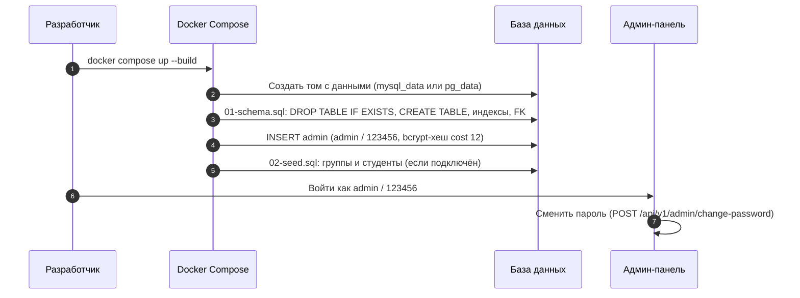

### 2. Регистрация устройства

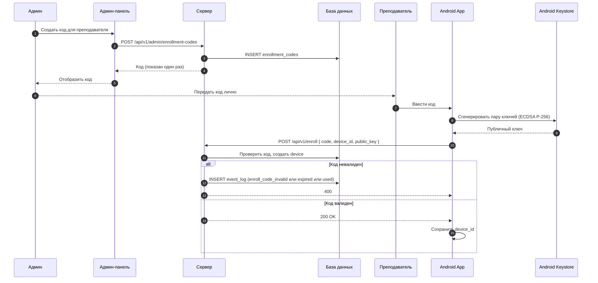

### 3. Отметка посещаемости

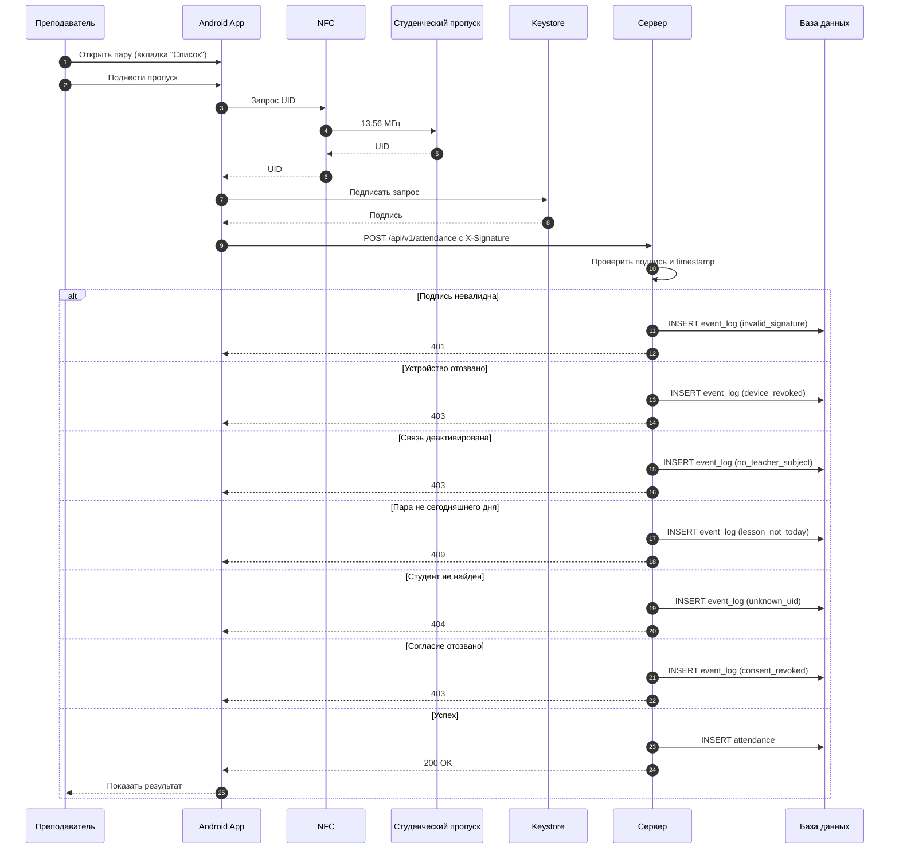

### 4. Получение пар и списка пришедших

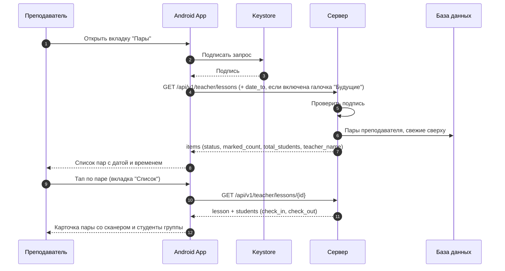

### 5. Отзыв согласия студента

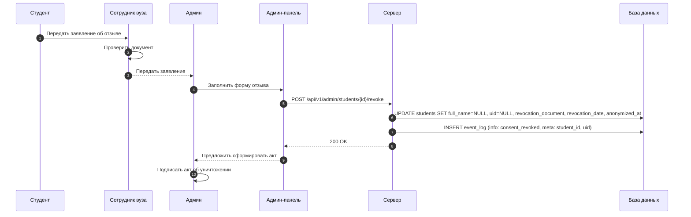

### 6. Добавление студента

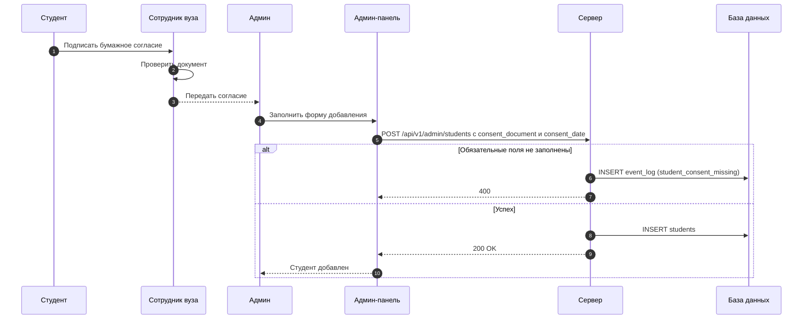

### 7. Просмотр журнала событий

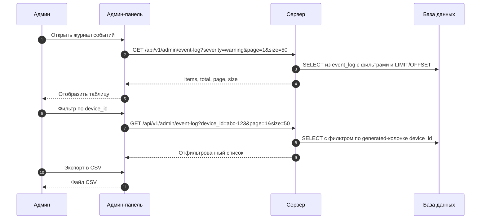

### 8. Импорт расписания

Админ загружает `.ics`-файл через `/admin/schedule/import` (форма) или
`POST /api/v1/admin/schedule/import` (API, multipart: `file`, `group_id`,
`group_name`).

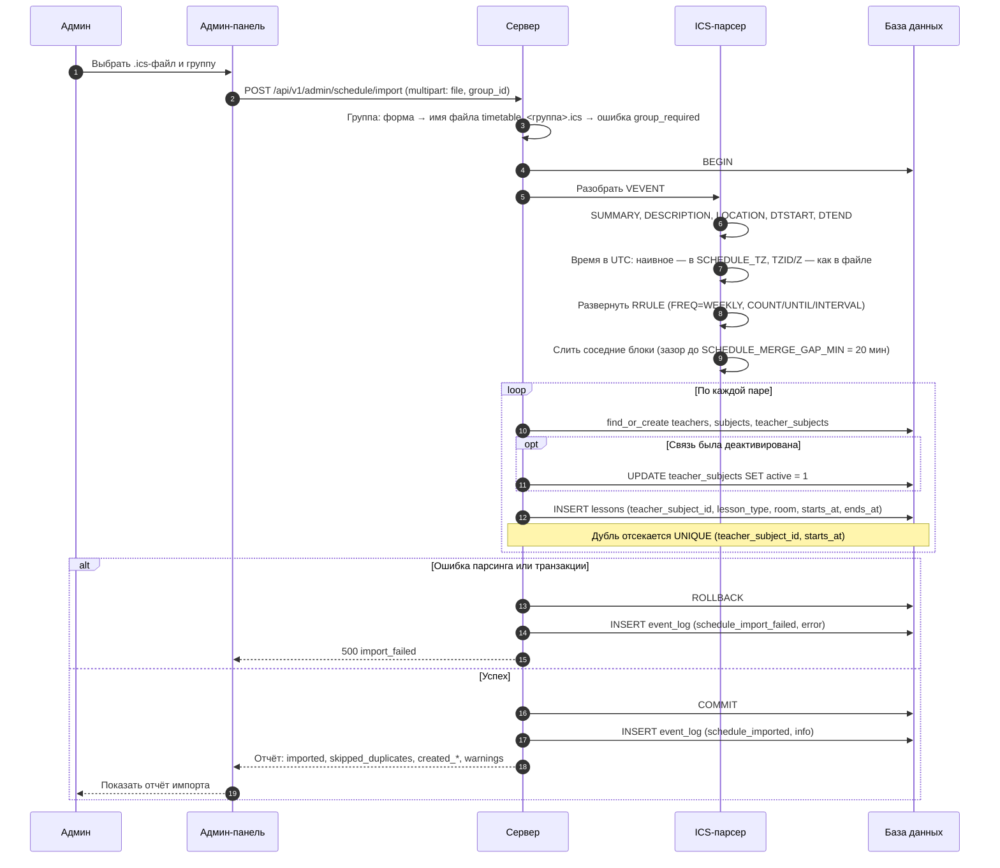

### 9. Очистка расписания

`DELETE /api/v1/admin/schedule` — API; в веб-панели это кнопка "Очистить расписание"
(`POST /admin/schedule/clear`).

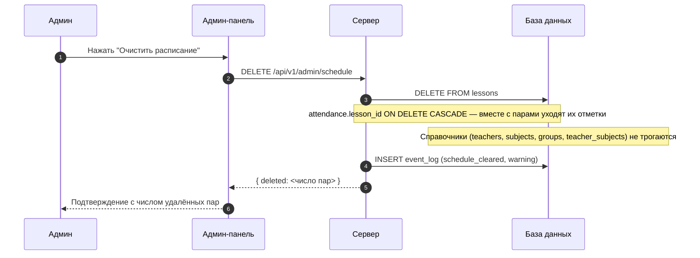

Справочники (`teachers`, `subjects`, `groups`, `teacher_subjects`) при очистке не
удаляются. Отметки уходят каскадом: ручного "начать пару" нет, и отличить
проведённую пару от запланированной нечем, а расписание ведётся внешней
ICS-выгрузкой, поэтому переимпорт неизбежен. Без каскада пара с отметками не
удалялась бы никогда. Загрузить новый файл поверх старого можно и без очистки:
повторный импорт того же ICS отсекается уникальным ключом
`(teacher_subject_id, starts_at)`.

# Роли

| Роль | Зона ответственности |
|---|---|
| **DB + Admin API** | Схема данных, миграции (под выбранную после определения хостинга СУБД), накат, бэкапы, описание БД, админ-эндпоинты, деплой БД, таблица `event_log` |
| **Backend Core** | Ядро API, middleware подписи, бизнес-логика отметок, деплой API, запись событий в `event_log`, пейджинг в ядре API, единый формат ответов, версионирование `/api/v1/` |
| **Android Core** | NFC, Keystore, подпись, HTTP-клиент, сервисы |
| **Android UI** | Экраны, навигация, ViewModel, отображение, постраничная навигация, сборка release-APK и тестовой APK |
| **Frontend / Admin Panel** | Веб-панель администратора, деплой админ-панели, размещение ссылки на APK, экран журнала событий (единственная точка доступа к логам), постраничная навигация |
| **Документация / Комплаенс + QA** | Документ архитектуры, 152-ФЗ, документы, инструкции, тест-план, интеграционные тесты, итоговый отчёт |

## Правила взаимодействия

- Драфт архитектуры (C1-C4, база данных: схема и ER-диаграмма, диаграммы последовательности) — общая точка входа.
- Документация / Комплаенс + QA ведёт документ архитектуры, фиксирует изменения, но не утверждает архитектуру единолично — решения принимаются совместно.
- **Последовательность выбора хостинга и СУБД:** хостинги исследует команда — кто именно занимается исследованием, договариваются устно. После определения хостинга DB + Admin API определяет, какая СУБД доступна (PostgreSQL 10+ или MySQL 8.0+), и только после этого пишет миграции и сиды. Сейчас в репозитории лежит вариант под MySQL.
- **Технологический стек** (язык и фреймворк бэкенда, фреймворк фронтенда, UI Android, формат аутентификации админа, Git-хостинг) определяется командой в начале проекта. Предложения готовят соответствующие роли, финальное решение — совместное.
- Изменения в схеме данных согласуются между DB + Admin API, Backend Core и Android Core.
- Изменения в API фиксируются Backend Core и доводятся до Android Core, Android UI и Frontend.
- Юридические формулировки утверждает Документация / Комплаенс + QA.
- Разработчики пишут unit-тесты на свою часть. Интеграционное тестирование — на Документация / Комплаенс + QA.
- Каждая роль предоставляет описание выбранной технологии, инструкцию по эксплуатации своей части и скриншоты. Формат — на усмотрение автора, содержание обязательно.
- Итоговый отчёт собирает Документация / Комплаенс + QA из готовых блоков, которые присылают все роли.
- **Git-процесс.** Работа ведётся в монорепозитории по схеме: `main` ← `dev` ← `feature/<роль>-<описание>`. Прямые коммиты в `main` и `dev` запрещены. Merge только через Pull Request.
- **Ревью.** Изменения в API ревьюит Backend Core. Изменения в схеме данных — DB + Admin API. Изменения в контракте Android Core ↔ UI — Android Core. Изменения в документации — Документация / Комплаенс + QA.

## Граница Android Core ↔ UI

Core определяет интерфейсы первыми, до реализации. UI пишет экраны против интерфейсов с мок-реализациями. Изменения в контракте согласуются между Core и UI напрямую.

## Репозиторий и работа с Git

**Структура репозитория (монорепо):**

```
app/
├── docker-compose.yml
├── .env.example
├── README.md
├── backend/
│   ├── Dockerfile
│   └── ...
├── frontend/
│   ├── Dockerfile
│   └── ...
├── db/
│   └── ...
├── android/
│   └── ...
└── docs/
│   └── ...
```

**Ветки:**

- `main` — стабильная версия. Защищена. Коммитить напрямую нельзя.
- `dev` — интеграционная ветка. Защищена. Коммитить напрямую нельзя.
- `feature/<роль>-<описание>` — для новых функций.
- `fix/<роль>-<описание>` — для исправлений.
- `docs/<описание>` — для документации.

**Рабочий процесс:**

1. Обновить `dev`: `git checkout dev && git pull`.
2. Создать ветку от `dev`: `git checkout -b feature/backend-attendance-endpoint`.
3. Работать и коммитить в свою ветку.
4. Пуш: `git push -u origin feature/backend-attendance-endpoint`.
5. Открыть Pull Request в `dev`.
6. Ревью от того, кто затронут. Изменения в API — ревью Backend Core. Изменения в схеме — ревью DB + Admin API.
7. После апрува — merge в `dev`.
8. Когда накопилось — `dev` сливается в `main`.

**Именование коммитов** (рекомендуется):

```
feat(backend): добавить endpoint отметки посещаемости
fix(android): исправить чтение UID при повторном сканировании
docs(152fz): обновить форму согласия
```

**Что не коммитить:**
- `.env` — только `.env.example` с описанием переменных.
- `docker-compose.override.yml` — личные настройки разработчика.
- Секреты: ключи, пароли, строки подключения.

**Что коммитить обязательно:**
- `docker-compose.yml` — один на всех (в сервисе db подставляется image: postgres... или image: mysql...).
- `.env.example` — с пустыми значениями и комментариями.
- `README.md` — инструкция по запуску.

## Инфраструктура и деплой

Деплой каждой части — ответственность соответствующей роли.

- **Frontend** — деплой админ-панели, размещение ссылки на APK в админ-панели.
- **Backend Core** — деплой API.
- **DB + Admin API** — деплой БД, накат миграций и сидов на прод-инстанс.
- **Android UI** — сборка release-APK и тестовой APK, передача файлов для публикации.

### Локальная разработка

**Принцип.** Чужие сервисы — в Docker. Свой код — нативно в IDE, но подключается к контейнерным сервисам. Это даёт быстрый старт, breakpoints из коробки и одинаковые версии СУБД у всей команды.

**Один `docker-compose.yml` в корне репозитория.** Описывает сервисы `db` и `backend` (Flask API + админ-панель). Роль запускает только нужные, — Docker сам поднимет зависимости через `depends_on`. В конфигурации `db` подставляется та СУБД, что выбрана на хостинге (PostgreSQL или MySQL); сейчас в файле — MySQL 8.4. SQL-скрипты из `backend/db/init/` монтируются в `docker-entrypoint-initdb.d` и применяются при первом создании тома.

**Команды запуска по ролям:**

| Роль | Команда | Что поднимается |
|---|---|---|
| DB + Admin API | `docker compose up db` | Только БД |
| Backend Core | `docker compose up db` | БД, Flask API запускает нативно |
| Frontend | `docker compose up` | БД и backend (админ-панель входит в него) |
| Android Core | `docker compose up` | БД и Flask API |
| Android UI | `docker compose up` | То же |
| Документация / QA | `docker compose up` | Всё целиком для проверки |

**Как запускать свой код нативно:**

- **Backend Core:** запускает сервер Flask локально, в `backend/.env` указывает `DB_HOST=localhost` и порт, который проброшен из контейнера `db` наружу (для MySQL — `3316`).
- **Frontend:** админ-панель — часть Flask-приложения (шаблоны Jinja2), отдельного dev-сервера нет. Запускается вместе с бэкендом: http://localhost:8010/admin.
- **Android:** запускает приложение в Android Studio, `BASE_URL` варианта `debug` указывает на `http://127.0.0.1:8010` (`adb reverse tcp:8010 tcp:8010`).

**Личные настройки.** Если нужно переопределить что-то только для себя, создаётся `docker-compose.override.yml` в корне. Он в `.gitignore` и не коммитится.

### Деплой на хостинг

**Хостинг без Docker.** Если хостинг не поддерживает контейнеры, развёртывание на проде делается вручную. Строка подключения задаётся через переменные окружения.

**Статика.** APK, макеты и другие медиа лежат в статике на том же хостинге, что API.

**Последовательность деплоя инфраструктуры:**
1. Команда определяет хостинг и доступную на нём СУБД (PostgreSQL 10+ или MySQL 8.0+).
2. На хостинге создаётся база и пользователь БД.
3. DB + Admin API применяет `01-schema.sql` (схема и админ `admin` / `123456`), при необходимости — `02-seed.sql`. Если СУБД на хостинге отличается от той, под которую написаны скрипты, они переписываются под неё.
4. Backend Core деплоит Flask-приложение, передавая параметры БД через переменные окружения (`DB_HOST`, `DB_PORT`, `DB_NAME`, `DB_USER`, `DB_PASSWORD`).
5. Админ входит в панель под `admin / 123456` и сразу меняет пароль.

Две среды (тест и прод) реализуются через два аккаунта на хостинге или два окружения в рамках одного аккаунта. Тестовая среда используется для проверок QA и командой: на ней разворачиваются тестовые сборки API, админ-панели и APK.

**Бэкапы прода.** На прод-инстансе БД настроен регулярный бэкап. Процедура восстановления описана в инструкции по эксплуатации БД. Ответственный — DB + Admin API.

**Retention event_log — вне MVP.** Автоматическая очистка старых записей не реализована;
журнал чистится вручную администратором БД. Ответственный за ручную очистку — DB + Admin API.

## Требования к артефактам ролей

Формат — на усмотрение автора. Содержание обязательно.

| Роль | Что предоставляет |
|---|---|
| **DB + Admin API** | Описание технологии (СУБД, инструмент миграций — если используется), итоговое описание БД под выбранную СУБД, инструкция по эксплуатации, инструкция по деплою БД и накату на прод, скриншоты |
| **Backend Core** | Описание технологии (язык, фреймворк, ORM — если используется, формат аутентификации админа), OpenAPI с описанием пейджинга, единый формат ответов, форматы событий и структура `meta`, инструкция по эксплуатации, инструкция по деплою API, скриншоты |
| **Android Core** | Описание технологии (язык, библиотеки), документ с интерфейсами, инструкция, скриншоты |
| **Android UI** | Описание технологии (UI-стек: Compose или XML), макеты, инструкция для преподавателя, скриншоты, release-APK и тестовая APK |
| **Frontend** | Описание технологии (фреймворк, инструменты сборки), макеты, инструкция для админа, инструкция по деплою админ-панели, скриншоты, макет экрана журнала событий |

## Расширенная сводная таблица по этапам

| Этап | DB + Admin API | Backend Core | Android Core | Android UI | Frontend | Документация / Комплаенс + QA |
|---|---|---|---|---|---|---|
| **Проектирование** | ER-диаграмма, таблицы, индексы (с вариантами под PostgreSQL и MySQL для понимания), контракты админ-API с пейджингом, схема `event_log` | C3 серверная часть, контракты ядра API с пейджингом, формат подписи, выбор языка и фреймворка бэкенда и формата аутентификации админа, единый формат ответов, версионирование `/api/v1/`, границы с DB, форматы событий и структура `meta` | Интерфейсы для UI, согласование формата подписи и заголовков | Экраны, навигация, контракт с Core, постраничная навигация, выбор UI-стека | Экраны админки, контракты с админ-API с пейджингом, экран журнала событий, выбор фреймворка фронтенда | 152-ФЗ, формы, акты, документ архитектуры, тест-план |
| **Разработка** | Миграции и сиды под **выбранную** СУБД, накат, бэкапы, админ-эндпоинты с пейджингом, транзакции, контейнеризация БД, таблица `event_log` | Эндпоинты ядра с пейджингом, middleware подписи, бизнес-логика отметки, Docker (локально), HTTPS, контейнеризация API, запись событий с `meta`, единый формат ответов | Keystore, подпись, ApiClient, сервисы, NFC, обработка ошибок | Экран регистрации, рабочий интерфейс, навигация, отображение ошибок и списка, постраничная навигация | Авторизация, экраны студентов, акт, коды, устройства, валидация форм, контейнеризация админ-панели, экран журнала событий, постраничная навигация | Документы, тексты на экранах, тестовые данные, чек-лист сдачи |
| **Тестирование** | Unit: миграции (под выбранную СУБД), админ-эндпоинты, пейджинг, целостность, отзыв согласия, event_log | Unit: подпись, бизнес-логика отметки, транзакции, пейджинг, запись событий, формат ответов | Unit: Keystore, подписываемая строка, сервисы с мок-HTTP, ручное NFC | Unit: ViewModel, ручное тестирование UI, навигация по страницам | Unit: валидация форм, клиент API, ручные сценарии админа, экран журнала, пейджинг | Интеграционное тестирование на тестовой среде, защищённость, регресс, баг-репорты |
| **Релиз** | Деплой БД на выбранный хостинг (PostgreSQL 10+ или MySQL 8.0+ — по факту), накат миграций и сидов на прод-инстанс, смена пароля админа, скрипты бэкапов и восстановления, развёртывание тестовой БД | Деплой API (Docker или ручное развёртывание), HTTPS, публичный URL, настройка прод- и тест-среды, развёртывание тестового API | Core-модуль, документация контракта для UI | Release-APK с продовым `BASE_URL`, тестовая APK с тестовым `BASE_URL`, передача файлов для публикации | Деплой админ-панели, настройка прод- и тест-среды, развёртывание тестовой админ-панели, размещение ссылки на APK | Финальная проверка документов, приёмка |
| **Итоговый отчёт** | Описание технологии, итоговое описание БД, инструкция по эксплуатации, скриншоты | Описание технологии, OpenAPI с пейджингом, форматы событий, инструкция по эксплуатации, скриншоты | Описание технологии, документ с интерфейсами, инструкция, скриншоты | Описание технологии, макеты, инструкция для преподавателя, скриншоты | Описание технологии, макеты, инструкция для админа, скриншоты | Сборка и оформление итогового отчёта |

Формат отчёта роли — на усмотрение автора, итоговый отчёт — по образцу дисциплины.
